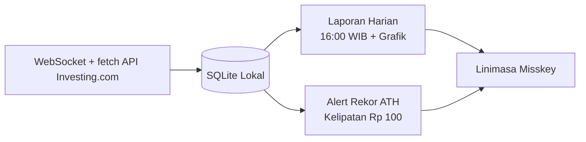

# USD to IDR Misskey Bot

Bot otomatis berbasis Node.js yang memantau dan memposting informasi kurs **USD (Dolar AS) ke IDR (Rupiah Indonesia)** beserta grafik pergerakan harga terbaru ke platform **Misskey**.

## ⚙️ Cara Kerja Singkat



| Komponen | Deskripsi |
|---|---|
| **Monitoring** | Streaming harga live 24/7 via WebSocket Investing.com, dilengkapi *heartbeat* otomatis dan *watchdog timer* pemulih koneksi. |
| **Database** | SQLite lokal (`data/kurs.db`) yang merangkum tick menjadi candle OHLC via kueri *upsert*, hemat memori (< 5 MB/tahun). |
| **Grafik** | Render chart kurva **1 minggu terakhir** berbasis candle 1 jam (`PT1H`), lengkap dengan label jam berurutan di atas tanggal pada sumbu X. |
| **Posting Harian** | Cron otomatis Senin–Sabtu pukul 16:00 WIB untuk membuat gambar grafik dan memposting laporan ke linimasa Misskey secara *offline-ready*. |
| **Alert ATH** | Pengecekan real-time di memori yang langsung memposting notifikasi saat kurs menembus rekor ATH baru kelipatan Rp 100 (contoh: Rp 17.600 $\rightarrow$ Rp 17.700). |

## 🛠️ Persyaratan Sistem

- **Node.js**: v24+ atau versi lebih baru
- **pnpm**: v10+ (atau npm/yarn/bun)

---

## 🚀 Cara Install & Konfigurasi

### 1. Clone & Install Dependensi

```bash
pnpm install
```

### 2. Konfigurasi Environment Variable

Salin file `.env.sample` menjadi `.env`:

```bash
cp .env.sample .env
```

Buka file `.env` dan lengkapi konfigurasi berikut:

```env
MISSKEY_API_BASE_URL=https://misskey.id/api
MISSKEY_ACCESS_TOKEN=your_misskey_access_token_here
MISSKEY_FOLDER_ID=your_folder_id_optional

CRON_TIMEZONE=Asia/Jakarta
USER_AGENT=USDtoIDR-Bot
```

---

## 💻 Cara Menjalankan

### Menjalankan Bot (Mode Normal)

Bot akan berjalan secara berkelanjutan di latar belakang sesuai jadwal cron:

```bash
pnpm start
# atau
npm run start
```

### Mode Testing (CLI)

Untuk melakukan pengujian posting note tanpa menunggu jadwal cron:

#### 1. Testing Lokal (Tanpa Mengirim ke Misskey)
Grafik akan digenerate dan disimpan ke file lokal `test-chart.png`, caption dipratinjau di terminal, dan panggilan API Misskey sepenuhnya dilewati:

```bash
# Test posting harian lokal
pnpm test:local

# Test pengecekan ATH lokal
pnpm test-ath:local
```

#### 2. Testing Pengiriman ke Misskey
Menguji alur penuh termasuk upload gambar dan posting note ke Misskey (default visibility: `specified`):

- **Test Posting Harian**:
  ```bash
  pnpm test
  # atau
  npm run test
  ```

- **Test Pengecekan ATH**:
  ```bash
  pnpm run test-ath
  ```
### Parameter Custom Visibility pada Mode Testing

Secara default, mode testing menggunakan visibilitas `specified` agar pengujian tidak mengotori linimasa publik Misskey. Anda dapat menentukan visibilitas kustom (`public`, `home`, `followers`, `specified`) secara fleksibel:

- **Test Posting Harian dengan Visibilitas Kustom**:

  ```bash
  # Menggunakan pnpm
  pnpm test public
  pnpm test home
  ```

- **Test Pengecekan ATH dengan Visibilitas Kustom**:

  ```bash
  # Menggunakan pnpm
  pnpm run test-ath public
  pnpm run test-ath specified
  ```
---

## 📄 Lisensi

[MIT License](LICENSE.md)
